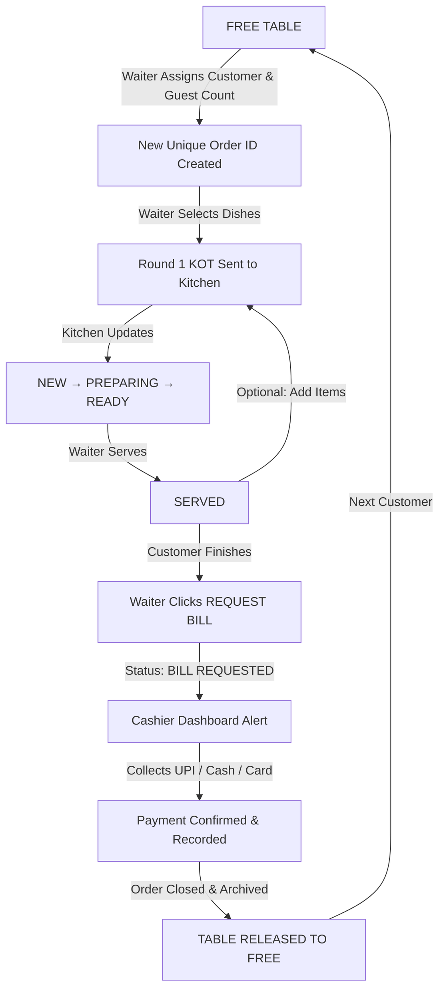

# Naga Hotel – Complete Restaurant Management System (RMS)

A modern, high-performance, responsive restaurant management web application built from scratch for **Naga Hotel**. Designed for seamless front-of-house and back-of-house coordination across Cashier, Waiter, Kitchen, and Administration staff.

---

## 🌟 Key Features & Dashboards

### 1. 💵 Cashier Dashboard (`/cashier`)
* **Real-time Table Matrix**: 12 tables displaying live statuses (`FREE`, `OCCUPIED`, `BILL REQUESTED`), active order values, customer names, and elapsed dining timers.
* **Instant Bill Alert Banner**: Top banner highlights tables awaiting bill settlement with one-click checkout.
* **Itemized Billing Calculation**: Server-accurate subtotal, 5% GST (2.5% CGST + 2.5% SGST), discounts (flat ₹ or %), and final total.
* **Multi-Mode Payment Settlement**:
  * **UPI**: Dynamic QR code modal & transaction reference tracking (`nagahotel@okhdfcbank`).
  * **Cash**: Amount tendered input with instant change/balance calculator and quick-currency buttons.
  * **Card**: POS transaction authorization and last-4-digits capture.
* **Immediate Table Release**: Confirming payment atomically closes the order, records the payment, and resets the table to `FREE`.
* **Printable Thermal Slip**: 80mm POS receipt format with hotel branding, GSTIN, itemized rates, and `window.print()` support.

### 2. 📱 Waiter Mobile POS (`/waiter`)
* **Mobile & Touch-Optimized Layout**: High-contrast, responsive interface for servers on smartphones and tablets.
* **Table Occupancy Protection**: Waiters cannot assign an already-occupied table. Free tables can be assigned with customer name and guest count.
* **Unique Order Generation**: Every guest session receives an isolated order ID (`ord-<timestamp>-<rand>`) and sequential invoice number.
* **Dynamic Menu & KOT Ordering**:
  * Category navigation tabs (Tiffins, Starters, Biryani, Gravies, Breads, Beverages, Desserts).
  * Vegetarian / Non-Vegetarian badges and Chettinad spicy level indicators.
  * Quantity steppers (`-` / `+`) and item-level special notes (e.g. *"less spicy"*, *"no onion"*).
* **Multi-Round KOT Submission**: Add extra items to active orders (marked as Round 1, Round 2, etc.) without losing previous items.
* **Live Prep Notifications**: Visual pulse indicators when items are marked `READY` by the kitchen, plus a *"Mark as Served"* button.
* **One-Tap Bill Request**: Waiter clicks **REQUEST BILL** when the party finishes. Table status transitions to `BILL REQUESTED` (remains occupied until the cashier confirms payment).

### 3. 👨‍🍳 Kitchen Display System (KDS) (`/kitchen`)
* **Large Touchscreen Order Tickets**: Displays Table #, Order #, Customer Name, elapsed timer (with red overdue highlight for >20 mins), and Round badges.
* **Item-Level Checklist**: Check individual items as `NEW` → `PREPARING` → `READY`.
* **One-Touch Ticket Actions**:
  * *Start Preparing All* (`NEW` → `PREPARING`)
  * *Mark All Ready* (`PREPARING` → `READY` – notifies floor waiter)
  * *Mark All Served* (`READY` → `SERVED`)
* **Audio Alerts**: Web Audio API synthesizer chimes when new tickets arrive or items are ready.

### 4. 🍽️ Admin Menu Management (`/admin/menu`)
* Full CRUD for food items and categories.
* Name, category, price, veg/non-veg status, spice level, and culinary description.
* Instant **In Stock / Out of Stock** toggle switch that immediately reflects on waiter ordering screens.
* Search and category filtering.

### 5. 📊 Billing History & Reports (`/admin/billing`)
* Audited chronological log of all completed payments.
* Revenue breakdown by payment method: Cash, UPI, and Card.
* Reprint past thermal receipts anytime.
* Search by invoice number or customer name.

---

## 🛠️ Technology Stack

| Layer | Technology |
|---|---|
| **Framework** | Next.js 16 (App Router, Turbopack, React 19) |
| **Language** | TypeScript (Strict mode) |
| **Styling** | Tailwind CSS v4 & Lucide React |
| **Database & Realtime** | Supabase (PostgreSQL, Triggers, RLS, BroadcastChannel fallback) |
| **Testing** | Node.js Test Suite with `tsx` |
| **Deployment** | Vercel Ready (`vercel.json`) |

---

## 📂 Project Architecture

```
res 2/
├── supabase/
│   ├── schema.sql                         # Complete PostgreSQL DDL, triggers & stored procedures
│   ├── seed.sql                           # 12 tables, 5 staff users, 26 menu items seed
│   └── migrations/
│       └── 20261013000000_init_naga_hotel.sql
├── src/
│   ├── app/
│   │   ├── page.tsx                       # Switchboard home with live metrics & flow chart
│   │   ├── layout.tsx                     # Global RootLayout with providers & theme
│   │   ├── globals.css                    # Tailwind CSS v4 styles & print rules
│   │   ├── cashier/page.tsx               # Cashier Counter Dashboard
│   │   ├── waiter/page.tsx                # Waiter Mobile POS
│   │   ├── kitchen/page.tsx               # Kitchen Display System (KDS)
│   │   ├── admin/
│   │   │   ├── menu/page.tsx              # Menu Catalog Management
│   │   │   └── billing/page.tsx           # Billing History & Analytics
│   │   └── api/
│   │       ├── health/route.ts            # System health check
│   │       ├── tables/route.ts            # Table listing & assignment
│   │       ├── orders/route.ts            # Orders listing
│   │       ├── orders/[id]/route.ts       # Single order status updates
│   │       ├── orders/[id]/items/route.ts # KOT items submission
│   │       ├── orders/[id]/request-bill/  # Request bill endpoint
│   │       ├── payments/route.ts          # Payment settlement & audit
│   │       ├── menu/route.ts              # Menu CRUD & availability toggle
│   │       └── reset-demo/route.ts        # Fresh state reset endpoint
│   ├── components/
│   │   ├── Navbar.tsx                     # Header with role switcher & metrics
│   │   ├── RoleSwitcher.tsx               # Quick role selector
│   │   ├── TableCard.tsx                  # Interactive table occupancy cards
│   │   ├── BillModal.tsx                  # Cashier settlement modal with tax & UPI/Cash/Card
│   │   ├── ThermalReceipt.tsx             # 80mm POS printable receipt
│   │   ├── StatusBadge.tsx                # Status badges & veg/non-veg tags
│   │   ├── NotificationToast.tsx          # Realtime toast notifications
│   │   └── SoundAlert.ts                  # Web Audio API chime synthesizer
│   ├── context/
│   │   └── RestaurantContext.tsx          # React Context & Hook
│   └── lib/
│       ├── types.ts                       # TypeScript definitions
│       ├── supabase/client.ts             # Supabase client wrapper
│       └── store/
│           ├── restaurant-store.ts        # State store with BroadcastChannel sync
│           └── initial-data.ts            # Initial seed fixtures
├── tests/
│   └── workflow.test.ts                   # 9-step automated end-to-end integration test
├── .env.example                           # Sample environment configuration
├── vercel.json                            # Vercel configuration
└── package.json
```

---

## 🚀 Getting Started (Local Development)

### 1. Prerequisites
* Node.js v18+ (tested on v24)
* npm v10+

### 2. Installation
```bash
npm install
```

### 3. Environment Variables
Copy `.env.example` to `.env.local`:
```bash
cp .env.example .env.local
```
*(Note: If Supabase keys are not set yet, the app automatically runs in resilient local sync mode with cross-tab BroadcastChannel communication. Once keys are supplied, it seamlessly binds to Supabase).*

### 4. Running the Development Server
```bash
npm run dev
```
Open **[http://localhost:3000](http://localhost:3000)** in your browser.

---

## 🧪 Running Automated Tests

Run the full end-to-end restaurant lifecycle test suite:
```bash
npm test
```

### Test Suite Covers:
1. Initial table state verification (Table 1 FREE).
2. Occupied table assignment guard (Double-booking blocked).
3. Waiter assigns Table 1 (Customer seated, unique Order ID generated).
4. Submitting Round 1 KOT food items (Subtotal, 5% GST, and total calculation).
5. Adding Round 2 extra items to active order.
6. Kitchen preparation transitions (`NEW` → `PREPARING` → `READY` → `SERVED`).
7. Waiter requests bill (`BILL_REQUESTED` – table remains occupied).
8. Cashier collects payment via UPI/Cash/Card → order closed, table freed.
9. Next customer receives fresh order on Table 1 (Zero items, clean slate, no leaks).

---

## 🗄️ Supabase Database Setup

To run with a live Supabase backend:

1. Create a project at [supabase.com](https://supabase.com).
2. Open the **SQL Editor** in your Supabase dashboard.
3. Paste the contents of `supabase/schema.sql` and run it.
4. Paste the contents of `supabase/seed.sql` and run it.
5. In your project settings, copy the **Project URL** and **Anon Public Key**.
6. Set them in your `.env.local` or Vercel environment variables:
   ```env
   NEXT_PUBLIC_SUPABASE_URL=https://your-project.supabase.co
   NEXT_PUBLIC_SUPABASE_ANON_KEY=eyJhbGciOi...
   ```

---

## ☁️ Deploying to Vercel

1. Push this repository to GitHub or GitLab.
2. Go to [vercel.com](https://vercel.com) and click **"Add New Project"**.
3. Import the repository.
4. Add the environment variables from `.env.example` (`NEXT_PUBLIC_SUPABASE_URL`, `NEXT_PUBLIC_SUPABASE_ANON_KEY`).
5. Click **Deploy**. Vercel will run `npm run build` and launch the application.

---

## 🔄 Exact Dining & Billing Lifecycle


